<div align="center">


<h1>GameIndex</h1>

<p><strong>Every PC game you own. One library.</strong></p>

<p>GameIndex is a local-first desktop launcher for Windows and Linux. It gathers Steam, GOG, Epic, Rockstar, Ubisoft, Humble and DRM-free installs into a single library, then keeps the rest of PC gaming in the same window: sessions, achievements, saves, mods, emulators, storage and deals.</p>

[](https://github.com/atxoxx/GameIndex/actions/workflows/ci.yml)
[](#license)
[](#requirements)
[](#roadmap)
[](#tech-stack)
[](#tech-stack)
[](#tech-stack)

<p>
  <a href="#download-and-install"></a>
  <a href="https://youtu.be/1PnELFTXH4g"></a>
  <a href="#documentation"></a>
</p>

</div>

> **Project status:** GameIndex is an actively developed, opinionated personal project. Expect rough edges and breaking changes between releases. `main` is the Electron app; the old `electron` branch is deprecated and kept only as a mirror. Release builds are produced from plain `v<version>` tags on `main` - see [Download and install](#download-and-install) for the current public build and the artifacts the release workflow produces.

---

## Table of contents

- [What GameIndex does](#what-gameindex-does)
- [Screenshots](#screenshots)
- [Features](#features)
  - [Library](#library)
  - [Game pages](#game-pages)
  - [Playing and tracking](#playing-and-tracking)
  - [Discovery](#discovery)
  - [Managing your install](#managing-your-install)
  - [Make it yours](#make-it-yours)
- [Download and install](#download-and-install)
  - [Electron v2.5.0](#electron-v250)
  - [Legacy Tauri build (v2.4.0)](#legacy-tauri-build-v240)
  - [Electron builds](#electron-builds)
  - [Requirements](#requirements)
  - [First run](#first-run)
- [Documentation](#documentation)
- [Build from source](#build-from-source)
  - [Prerequisites](#prerequisites)
  - [Development commands](#development-commands)
  - [API keys](#api-keys)
  - [Project layout](#project-layout)
  - [Tech stack](#tech-stack)
- [Privacy and security](#privacy-and-security)
- [FAQ and troubleshooting](#faq-and-troubleshooting)
- [Contributing](#contributing)
- [Roadmap](#roadmap)
- [License](#license)
- [Acknowledgements](#acknowledgements)

---

## What GameIndex does

Most PC libraries are spread across store clients, browser tabs, folder trees and spreadsheets. GameIndex treats all of it as one collection: the same grid holds a Steam game, a GOG installer, an Epic title, an emulated ROM and a DRM-free folder you dropped in yourself. Every entry is editable, every view is filterable, and nothing is hidden behind an account.

A few principles shape the app:

- **One library, real filtering.** Store sync and manual imports feed a single catalogue with scopes, filters, sorting, grouping and saved smart shelves.
- **Local-first by default.** Your library, sessions, notes and settings live in SQLite on your machine. There is no GameIndex account and no analytics service.
- **The whole install, not just the launcher.** Playtime, performance, achievements, save snapshots, mods, emulators, disk usage and downloads all sit next to the games they belong to.
- **Desktop and couch.** The same library powers a full keyboard-and-mouse UI and a controller-first Big Picture mode with five layout presets.

---

## Screenshots

<sub>Captured at 1920 px wide from development builds. Layouts, labels and theme defaults change between releases.</sub>

| Library | Game page |
|:---:|:---:|
| 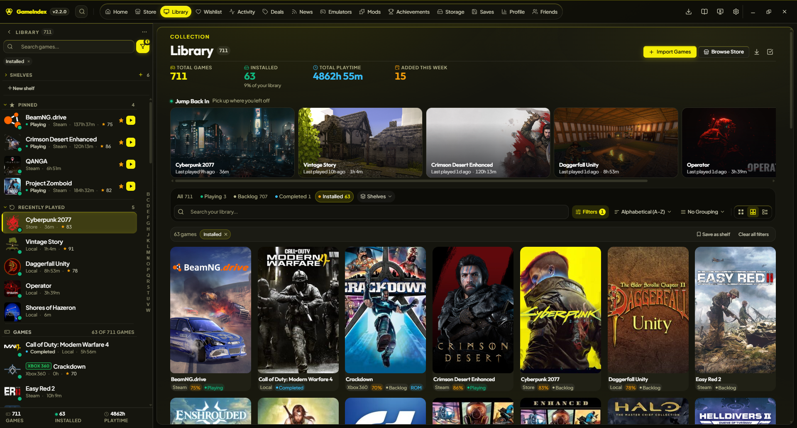 |  |
| One grid for every store, with pinned games, scopes, filters and smart shelves. | A game's hub: hero art, ratings, time to beat, DLC, notes, saves and maps. |

| Store | Deals |
|:---:|:---:|
| 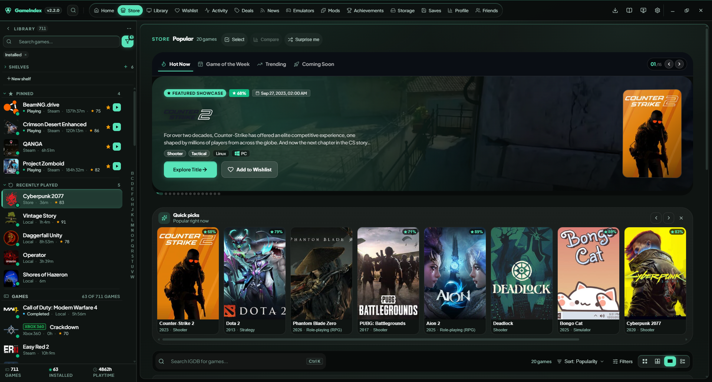 | 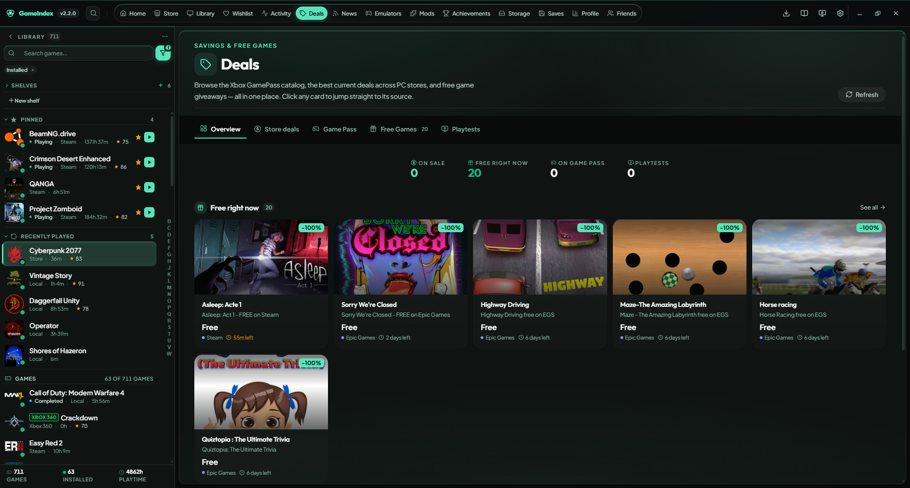 |
| An IGDB-powered catalogue with rails, filters and side-by-side comparison. | Live store prices, free games, giveaways, Game Pass titles and playtests. |

| Activity | Profile |
|:---:|:---:|
| 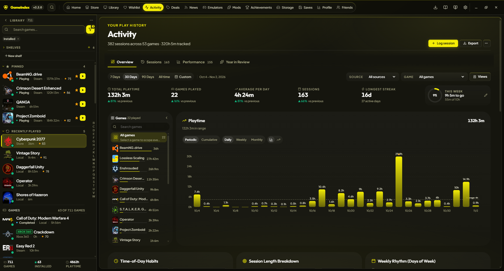 | 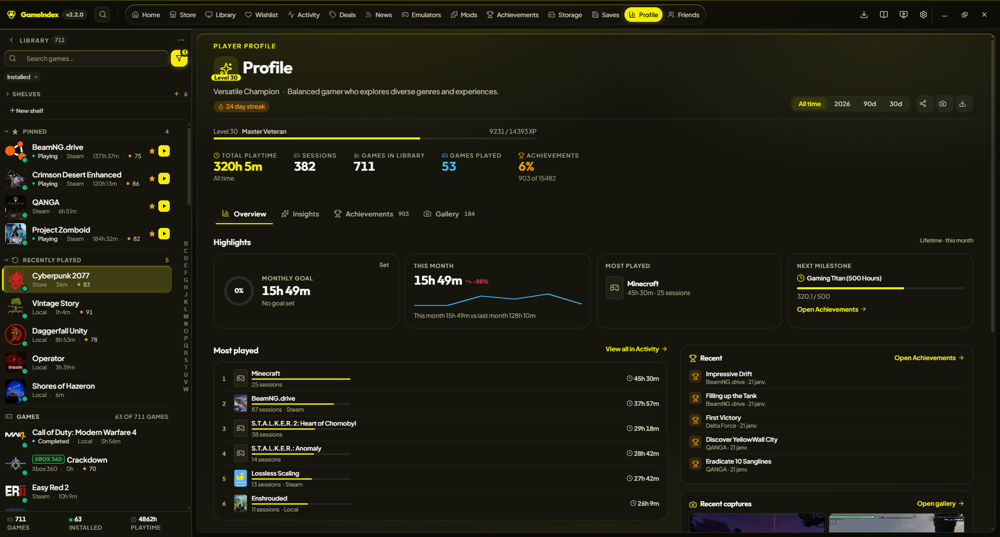 |
| Session history with playtime, performance and year-in-review views. | Level, streaks, goals, achievements and your most-played games. |

| Achievements | Mods |
|:---:|:---:|
| 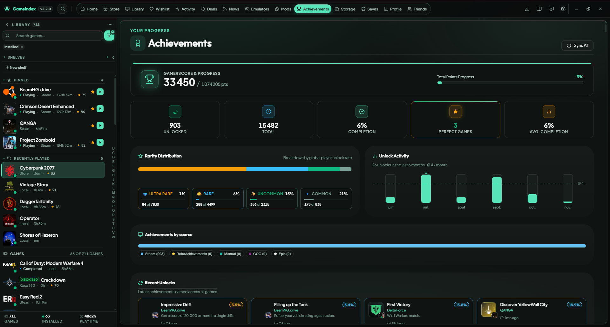 | 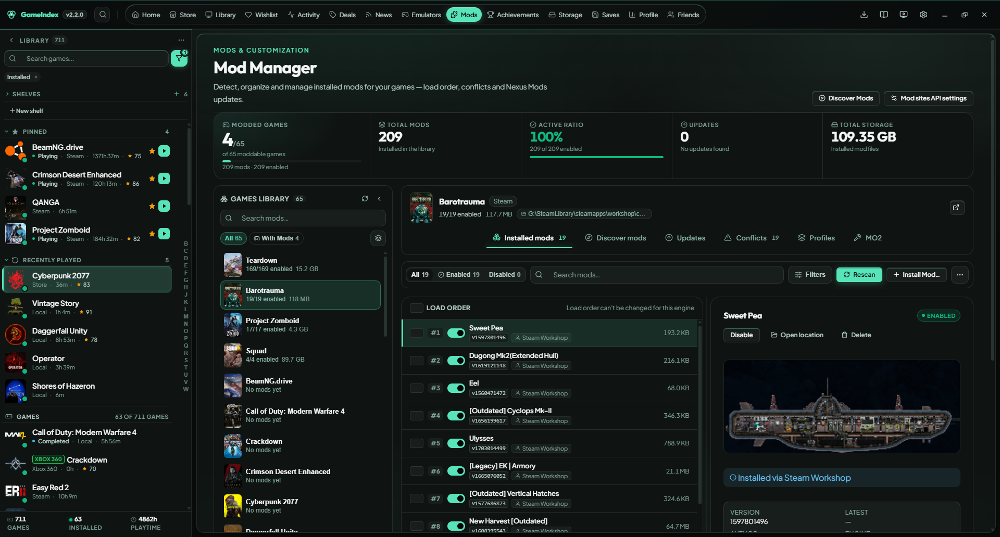 |
| Achievements from all five sources, with rarity, completion and unlock activity. | Installed mods, load order, conflicts, profiles, updates and MO2 import. |

| Emulators | Storage |
|:---:|:---:|
| 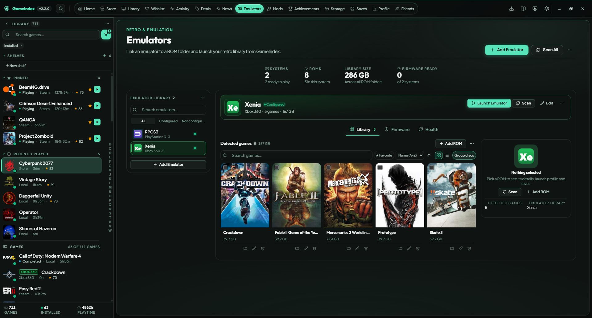 | 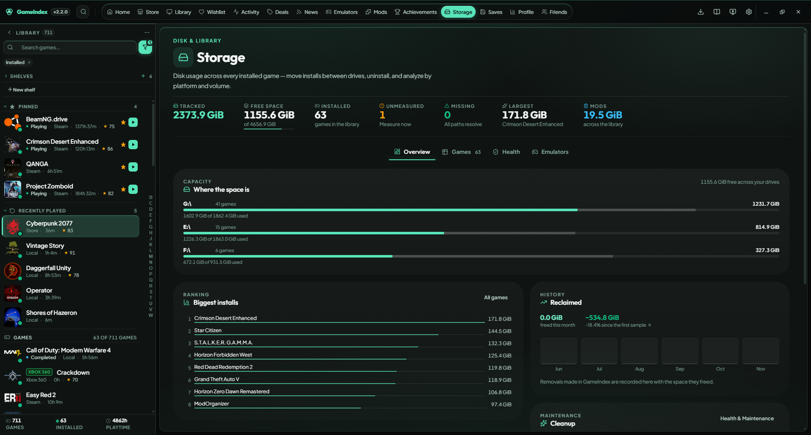 |
| Emulator platforms, ROM folders, firmware checks and a library health scan. | Per-drive usage, biggest installs, game folders and reclaim history. |

| Downloads | News |
|:---:|:---:|
| 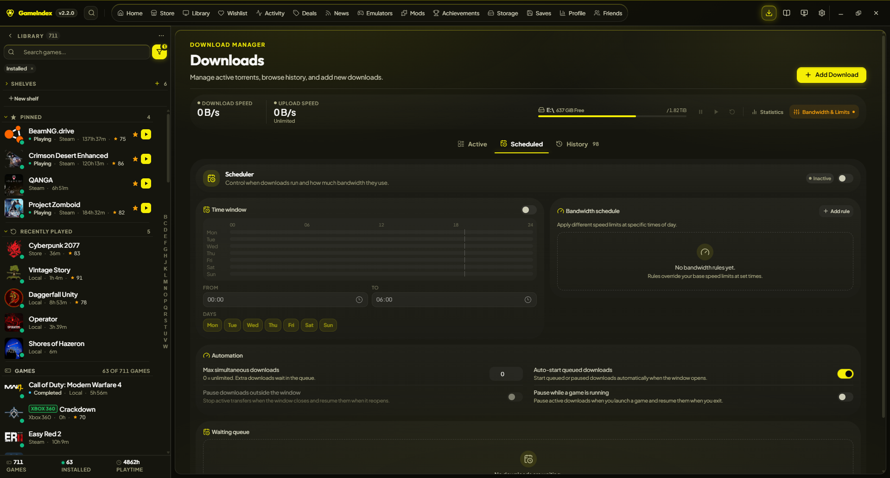 | 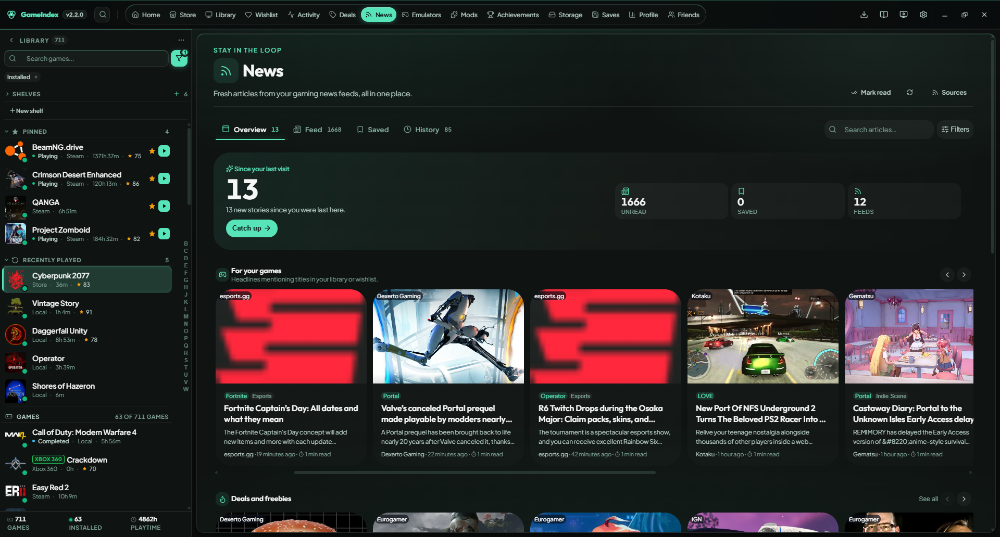 |
| A transfer queue with scheduling, bandwidth rules and pause-on-game. | An RSS briefing with unread, saved and history views. |

| Notes | Linux compatibility |
|:---:|:---:|
|  | 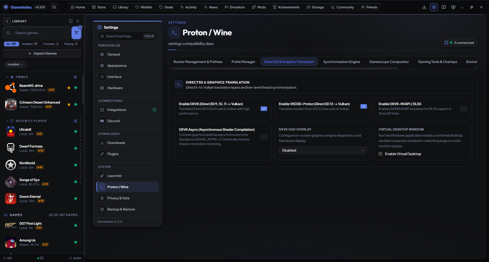 |
| Per-game Markdown notes with tags, search and write/preview/split modes. | Proton/Wine runners and graphics settings in the Linux build (earlier UI). |

> More screenshots - including friends, wishlist and additional game-page views - live in [`Screenshots/`](./Screenshots).

---

## Features

Everything below is implemented in the app unless a bullet is marked **beta** or **planned**. External data depends on the services and API keys described in [API keys](#api-keys).

### Library

- **Store connections.** Steam, GOG, Epic and Humble support account sign-in and library sync (Steam uses a Web API key). Rockstar Games Launcher and Ubisoft Connect installs are detected from disk. Battle.net, EA app, Xbox / Microsoft Store and itch.io are **beta** local-library connectors.
- **Manual and DRM-free imports.** Point GameIndex at a folder; it groups executables, suggests the main binary, and matches the game against IGDB so covers and metadata arrive with it.
- **Scopes and filters.** Browse everything, currently playing, backlog, completed or installed-only, then narrow by genre, platform, release year, rating, source, play status, VR or recompilation status.
- **Smart shelves.** Save any filter combination as a shelf, pin it to the sidebar, and it keeps updating as the library changes.
- **Installed state.** GameIndex detects what is actually installed and where, so a store entry you removed is not presented as playable.
- **Emulators and ROMs.** Manage emulator platforms, ROM folders and firmware/BIOS checks, group multi-disc games, and run a health scan for missing files.

### Game pages

- **Metadata and artwork.** IGDB details, hero art, genres, franchises, similar games and developer catalogues, with Steam data merged in where available.
- **Ratings and reception.** IGDB scores, Steam user reviews, HowLongToBeat estimates, Metacritic/OpenCritic scores, live Steam player counts and release status.
- **DLC and add-ons.** Ownership progress, prices, sales and a per-game DLC list.
- **Media.** Trailers, screenshots and artwork in a dedicated media view.
- **Maps.** Checks several community map providers, lists the ones that match, and previews the chosen map in the embedded browser.
- **Notes.** A Markdown workspace with tags, search, write/preview/split modes and export.
- **Web links.** Wikis, guides and PCGamingWiki pages open in an embedded browser without leaving the app.
- **News, saves, achievements and mods** each have their own tab on the same game page.

### Playing and tracking

- **Launch options.** Arguments, run as administrator, pre-launch and post-exit scripts, working directories, and multiple executables per game.
- **Performance telemetry.** Per-session FPS and frametime with 1% / 0.1% lows, CPU/GPU/RAM readings and timelines. On Windows, FPS comes from RTSS shared memory and temperatures/clocks from LibreHardwareMonitor or MSI Afterburner where available; on Linux, GameIndex reads the MangoHud CSV log written by the compatibility launcher.
- **In-game overlay.** A collapsed ticker and an expandable panel with session stats, performance graphs, captures, guides, notes, a timer, achievements, downloads and quick settings. **Off by default.** The toggle hotkey is `Shift+F1` and the screenshot hotkey is `F12`; both are configurable.
- **Screenshots and clips.** One-key screenshots on Windows and Linux, plus manual recording and a rolling replay buffer on Windows. Video capture shells out to `ffmpeg` and is unavailable when ffmpeg is not on `PATH`.
- **Achievements.** Steam, RetroAchievements, GOG, Epic and manual lists in one place, with rarity distribution, completion percentages, perfect games and recent unlocks.
- **Activity and Profile.** Sessions, playtime charts, time-of-day habits, session-length breakdowns, weekly rhythm, year in review, level, streaks, goals and most-played games.
- **Discord Rich Presence.** Shows the game you are playing, the page you are browsing or the download in progress.
- **Friends.** A local-first friends list, activity digest and messages, synced through encrypted Nostr relays - no account server and no port forwarding.

### Discovery

- **Store.** An IGDB-powered catalogue with featured rails, trending and coming-soon sections, filters, and comparison of up to four games side by side.
- **Deals.** Prices from IsThereAnyDeal and CheapShark across Steam, GOG, Epic, Humble, Fanatical, Green Man Gaming and others, grouped per game with best-offer and savings columns.
- **Free games, giveaways and Game Pass.** Dedicated views for free-now offers, active giveaways, Xbox Game Pass titles and Playtester.io playtests.
- **Wishlist.** Release countdowns, out-now and coming-soon filters, per-game notes, and one-click sharing to friends.
- **News.** A configurable RSS briefing with unread counts, per-game headlines, saved articles, reading history and feed management.
- **Community ports and VR mods.** A catalogue of unofficial PC ports (static recompilations, decompilations, recreations and wrappers) merged from public sources, plus a bundled VR mods catalogue.

### Managing your install

- **Save protection.** Detects save locations from a curated registry, Steam Cloud userdata, Proton prefixes and heuristic scans, then snapshots them into compressed `.gisave` archives on demand or automatically when a game exits. Restores can take a safety snapshot first.
- **Mods.** Nexus Mods and Steam Workshop are the two supported sources. Manage installed mods, load order, conflicts, update checks, profiles and a Mod Organizer 2 import, or browse and bookmark mods from Discover.
- **Storage.** Per-drive capacity, biggest installs, emulator and mod footprints, move game folders between drives, cleanup suggestions, reclaim history and a library health view for missing paths and stale entries.
- **Backup and restore.** Export the app's databases and settings - optionally artwork - as a `.gibak` archive; restore selected categories in merge or replace mode, with a pre-restore safety snapshot.
- **Downloads.** An optional transfer manager for HTTP downloads, torrents and AllDebrid, Real-Debrid, Premiumize or TorBox, with a queue, time-window scheduler, bandwidth rules and pause-on-game.
- **Plugins.** Sandboxed QuickJS search plugins add extra download sources. Plugins are plain `.js` files, evaluated in a fresh sandbox with memory and instruction budgets - never with Node or filesystem access.

### Make it yours

- **Six UI styles**: Classic, Material You 3, Steam Client, Cyberdeck, Fluent and Liquid Glass.
- **Themes and accents.** Light and dark variants, a large built-in color-theme library, a theme creator with live preview, JSON import/export, and an optional accent sampled from the active game's artwork.
- **Layout Studio.** Reorder navigation tabs, header buttons, sidebars, page widgets and detail tabs, with previews and a full layout snapshot you can export or import as JSON.
- **Simple UI mode.** Hides advanced surfaces at once when you want a quieter launcher, with an in-app setup wizard on first run.
- **Big Picture mode.** A controller-first shell with Home, Library, Store, Discover, Friends and Settings sections, plus five TV layout presets: Xbox, Steam, PlayStation, Switch and GameIndex.
- **Command palette.** `Ctrl+K` searches games, pages, settings and actions, with a preview pane and pinnable commands.
- **The small things.** Six languages (English, Spanish, French, German, Russian and Simplified Chinese), grid and list layouts, a resizable sidebar that collapses to an icon rail, right-click menus, system tray, run at login, and an in-app Guide at `/docs`.

---

## Download and install

### Electron v2.5.0

The first Electron release is [v2.5.0](https://github.com/atxoxx/GameIndex/releases/tag/v2.5.0), built from `main` for Windows and Linux:

| Platform | File | Notes |
|---|---|---|
| **Windows** | [`GameIndex_electron_2.5.0_x64-setup.exe`](https://github.com/atxoxx/GameIndex/releases/download/v2.5.0/GameIndex_electron_2.5.0_x64-setup.exe) | Installer with Start Menu shortcuts and in-app updates. |
| **Windows** | [`GameIndex_electron_2.5.0_x64_portable.exe`](https://github.com/atxoxx/GameIndex/releases/download/v2.5.0/GameIndex_electron_2.5.0_x64_portable.exe) | Single executable; nothing to install. |
| **Linux** | [`GameIndex_electron_2.5.0_amd64.AppImage`](https://github.com/atxoxx/GameIndex/releases/download/v2.5.0/GameIndex_electron_2.5.0_amd64.AppImage) | Make it executable (`chmod +x`) and run it. |
| **Linux** | [`GameIndex_electron_2.5.0_amd64.deb`](https://github.com/atxoxx/GameIndex/releases/download/v2.5.0/GameIndex_electron_2.5.0_amd64.deb) | `sudo apt install ./GameIndex_electron_2.5.0_amd64.deb` on Debian/Ubuntu derivatives. |

The packaged app shows its version in the header and updates through the `electron-latest` release feed.

### Legacy Tauri build (v2.4.0)

The installers in the [v2.4.0 release](https://github.com/atxoxx/GameIndex/releases/tag/v2.4.0) were built before the Electron migration. They are working builds of the same app and use the plain `GameIndex_<version>` names. A newer `v2.4.0-tauri` re-release carries the same version under `GameIndex_tauri_<version>` names.

| Platform | File | Notes |
|---|---|---|
| **Windows** | [`GameIndex_2.4.0_x64-setup.exe`](https://github.com/atxoxx/GameIndex/releases/download/v2.4.0/GameIndex_2.4.0_x64-setup.exe) | Installer with Start Menu shortcuts and in-app updates. |
| **Windows** | [`GameIndex_2.4.0_x64_portable.exe`](https://github.com/atxoxx/GameIndex/releases/download/v2.4.0/GameIndex_2.4.0_x64_portable.exe) | Single executable; nothing to install. |
| **Linux** | [`GameIndex_2.4.0_amd64.AppImage`](https://github.com/atxoxx/GameIndex/releases/download/v2.4.0/GameIndex_2.4.0_amd64.AppImage) | Make it executable (`chmod +x`) and run it. |
| **Linux** | [`GameIndex_2.4.0_amd64.deb`](https://github.com/atxoxx/GameIndex/releases/download/v2.4.0/GameIndex_2.4.0_amd64.deb) | `sudo apt install ./GameIndex_2.4.0_amd64.deb` on Debian/Ubuntu derivatives. |

### Electron builds

Future Electron releases are produced from `main`. Pushing a plain `v<version>` tag that matches `package.json` builds Windows and Linux installers and attaches them to a draft GitHub release:

| Platform | Artifact |
|---|---|
| **Windows** | `GameIndex_electron_<version>_x64-setup.exe` |
| **Windows** | `GameIndex_electron_<version>_x64_portable.exe` |
| **Linux** | `GameIndex_electron_<version>_amd64.AppImage` |
| **Linux** | `GameIndex_electron_<version>_amd64.deb` |

The workflow publishes the release automatically once both platforms succeed. It is not created for tags on other branches, for `v*-electron`/`v*-tauri` legacy tags, or when the tag and `package.json` version disagree. Until the next Electron release is published, [build it from source](#build-from-source).

### Requirements

- **Windows 10 or 11, x64.** The legacy v2.4.0 Tauri installer uses the Microsoft Edge WebView2 runtime, which ships with Windows 11 and installs with the setup if missing. The Electron build bundles Chromium and does not need WebView2.
- **A modern x64 Linux distribution.** Use the AppImage or install the `.deb`. Linux support works but still has rough edges, especially around Wayland overlays and video capture - see the [Linux guide](./docs/linux-wine-proton.md).
- **No macOS build.** A DMG target exists in `electron-builder.yml`, but no CI job builds or publishes it and it is not supported.
- **API keys.** Official installers bake in the keys for IGDB, OpenCritic, Discord and SteamGridDB. A local build without keys still runs; the affected features explain which variable is missing.

### First run

1. **Walk through the setup wizard.** Choose a UI style, accent, language and density, pick which features and libraries you want, and set a downloads folder. Everything here can be changed later in Settings.
2. **Connect your stores.** Steam needs a free [Web API key](https://steamcommunity.com/dev/apikey); GOG, Epic and Humble sign in through an in-app browser window. The beta connectors import games already installed by their clients.
3. **Sync or import.** Store games arrive with artwork and metadata. For a DRM-free folder, drop it on the library and confirm the suggested executable and IGDB match.
4. **Turn on optional features.** The overlay, save protection, video capture and the download manager are off or limited until you enable them.
5. **Open the Guide** at `/docs` (also available in Big Picture) whenever a screen needs explaining.

---

## Documentation

| Where | What it covers |
|---|---|
| In-app **Guide** (`/docs`) | Every feature, written for users and searchable from the command palette. |
| [`docs/linux-wine-proton.md`](./docs/linux-wine-proton.md) | Runners, prefixes, DXVK/VKD3D, GameScope, MangoHud, GPU pinning and Wine logs. |
| [`docs/in-game-overlay.md`](./docs/in-game-overlay.md) | The ticker and panel, hotkeys, capture, replay buffer and platform limits. |
| [`docs/mods-discover.md`](./docs/mods-discover.md) | Mod sources, mapping games, browsing, installs, profiles and conflicts. |
| [`docs/plugins/README.md`](./docs/plugins/README.md) | Plugin API, manifest schema, sandboxing and the authoring checklist. |
| [`knowledge.md`](./knowledge.md) | Architecture notes, storage, integrations and repository conventions. |
| [`electron/main/ARCHITECTURE.md`](./electron/main/ARCHITECTURE.md) | The main-process contract: commands, events, data ownership and libraries. |
| [`todo.md`](./todo.md) | The working roadmap, including known gaps. |
| [Discussions](https://github.com/atxoxx/GameIndex/discussions) | Questions, ideas and show-and-tell. |
| [Issues](https://github.com/atxoxx/GameIndex/issues) | Bug reports and feature requests. |

---

## Build from source

### Prerequisites

- [Node.js](https://nodejs.org) `^20.19.0` or `>=22.12.0` (required by Vite 7) with npm
- Git
- Windows or Linux for the desktop app. No Rust toolchain is needed: the native layer is Electron's main and preload processes.

```bash
git clone https://github.com/atxoxx/GameIndex.git
cd GameIndex
git switch electron
npm install
npm run dev:electron
```

`npm run dev` runs the renderer alone in a browser at `http://localhost:1420` with the desktop bridge stubbed. Use it for quick UI work; `dev:electron` is the real app with hot reload.

### Development commands

| Command | What it does |
|---|---|
| `npm run dev` | Vite renderer only, on port 1420. |
| `npm run dev:electron` | Full Electron app with hot reload. |
| `npm run typecheck` | Strict TypeScript check across `src/` and `electron/`. |
| `npm run lint` | ESLint over `src/`, zero warnings allowed. |
| `npm test` | Vitest suite. |
| `npm run test:watch` | Vitest in watch mode. |
| `npm run lint:plugins` | Validates local search plugins in `plugins/`. |
| `npm run audit:i18n` | Checks all six locale dictionaries for missing keys, placeholders and unresolved calls. |
| `npm run build` | Builds main, preload and renderer into `out/`. |
| `npm run dist` | Builds and packages for the current platform into `release/`. |
| `npm run dist:win` | Windows NSIS installer and portable executable. Run on Windows. |
| `npm run dist:linux` | Linux AppImage and `.deb`. Run on Linux. |
| `npm run verify:artifacts` | Confirms the packaged files use the expected `GameIndex_electron_...` names. |

### API keys

Keys are read from `process.env` first, then a local `.env`, and are baked into the packaged main bundle at build time. Copy [`.env.example`](./.env.example) to `.env` before building. Never commit real values.

| Variable | Used for | Notes |
|---|---|---|
| `TWITCH_CLIENT_ID`, `TWITCH_CLIENT_SECRET` | IGDB metadata and search | Required for store, game pages and imports. `IGDB_CLIENT_ID` / `IGDB_CLIENT_SECRET` work as fallbacks. |
| `OPENCRITIC_RAPIDAPI_KEY` | Critic scores | Optional; the OpenCritic page is scraped when no key is set. |
| `DISCORD_CLIENT_ID` | Rich Presence | Optional. |
| `STEAMGRIDDB_API_KEY` | Community artwork | Optional; IGDB/Steam artwork is used without it. |
| `STEAM_API_KEY` | Owned-games sync and achievements fallback | Optional if you paste a Steam key in Settings or use a Steam session. |
| `NEXUS_API_KEY` | Nexus Mods | Optional; the key can also be entered in Settings. |
| `REAL_DEBRID_KEY`, `ALL_DEBRID_KEY`, `PREMIUMIZE_KEY`, `TORBOX_KEY` | Debrid downloads | Optional; keys can also be entered in Settings. |

Missing keys do not crash the app. The affected command fails with a message naming the variable, and the rest of the app keeps working.

### Project layout

```text
GameIndex/
  src/                        React renderer
    pages/                    One folder or module per route (Library, Game, Store, ...)
    components/<area>/        Feature-scoped UI (game, store, deals, mods, bigscreen, ...)
    context/                  Shared providers (games, theme, language, density, setup, ...)
    hooks/  state/  utils/    Reusable renderer logic and typed state
    styles/                   Design tokens, themes and page styles
    i18n/                     Six locale dictionaries and the docs translations
    bigscreen/                Big Screen routes, presets and layout registry
    shims/                    `@tauri-apps/*` aliases that call the Electron bridge
  electron/
    main/
      index.ts                App lifecycle and boot order
      ipc.ts                  The single `invoke` router, events and window verbs
      commands/               One registrar per feature area
      features/<area>/        Backend implementations (library, stores, mods, ...)
      state/                  Settings documents and the SQLite domain layer
      surfaces/               Windows, tray, overlay, splash and embedded webviews
      lib/                    HTTP, secrets, paths, autostart and asset helpers
    preload/index.ts          `window.__giBridge` contextBridge contract
  build/                      App icons and tray image used by the packager
  Screenshots/                Screenshots used by this README
  docs/                       User and contributor guides
  plans/                      Design and implementation plans
  scripts/                    Build, audit, packaging and verification scripts
  electron-builder.yml        Packaging targets and artifact names
  electron.vite.config.ts     Main, preload and renderer build configuration
```

### Tech stack

| Layer | Choices |
|---|---|
| **Desktop** | Electron 38, electron-vite 4, electron-builder 26, electron-updater |
| **Renderer** | React 19, TypeScript 5.8, React Router 7, Vite 7, lucide-react, custom CSS design tokens |
| **Data** | better-sqlite3 with one SQLite database per domain, plus Electron `safeStorage` for secrets |
| **Networking** | Native fetch plus Electron's Chromium network stack where a site requires it, cheerio for HTML parsing, custom cookie jars per integration |
| **Media and transfers** | WebTorrent, parse-torrent, external ffmpeg for Windows video capture |
| **Plugins** | quickjs-emscripten sandbox with memory and instruction budgets |
| **Social** | nostr-tools for encrypted friend sync |
| **Quality** | Vitest 4, Testing Library, ESLint 9, strict TypeScript |

---

## Privacy and security

- **No account, no analytics.** GameIndex does not ship a telemetry or crash-reporting SDK. Network requests go only to the services behind features you have enabled - store data, metadata, artwork, prices, feeds or updates.
- **Local storage.** The library, sessions, notes, shelves, wishlist, saves and news live in SQLite files under the app's `userData` directory. UI preferences live in SQLite or the app's local storage under the same root, and cached images stay there too; scratch files use the system temp directory.
- **Encrypted credentials.** Store tokens, the Steam session and the Nostr signing key go through Electron `safeStorage` (DPAPI on Windows, the OS keyring on Linux where one is available). A Linux session without a working keyring degrades to Electron's basic fallback or plain records in `kv.db`, so protect the app data directory in that case. Values are never written to the renderer's storage.
- **Sandboxed plugins.** Plugin code runs in QuickJS, not Node and not the webview, with no filesystem or process access. A plugin is still executable code: install only plugins you trust, and read the [plugin security notes](./docs/plugins/README.md#security-model).
- **Backups are plain archives.** A `.gibak` backup is a deflated zip containing NDJSON and artwork. It is not encrypted, so treat it as sensitive data.
- **Unsigned builds.** Release executables are not code-signed. Windows SmartScreen may warn about an unknown publisher; the source is open, and you can build the binary yourself.

| Platform | Application data |
|---|---|
| Windows | `%APPDATA%\gameindex` |
| Linux | `~/.config/gameindex` |

Inside that directory, `db/` holds the SQLite domains (for example `games.db`, `sessions.db`, `kv.db` and `plugins.db`), and `cache/` holds regenerable data. Existing data from earlier GameIndex builds, including the pre-Electron app directory, is imported on first run where it can be read safely.

---

## FAQ and troubleshooting

### Is there an Electron installer?

Yes. [v2.5.0](https://github.com/atxoxx/GameIndex/releases/tag/v2.5.0) is the first Electron release, with Windows installer/portable and Linux AppImage/deb builds. The [legacy v2.4.0 Tauri build](#legacy-tauri-build-v240) remains available for comparison. You can also build `main` with `npm run dist:win` or `npm run dist:linux`.

### Windows says the publisher is unknown

Release builds are not code-signed, so SmartScreen and some antivirus heuristics treat a fresh binary as suspicious. Check that the file came from this repository's [releases page](https://github.com/atxoxx/GameIndex/releases), or build it yourself from source and compare the behavior.

### A connected store shows no games

- Confirm the account is connected in **Settings > Stores & accounts** and run a sync.
- Steam needs a Web API key and a public profile for owned-games sync.
- Battle.net, EA, Xbox and itch.io are beta local-library connectors; their client formats change without notice.
- A game installed outside the store's known folders may need a manual import.

### Covers, scores or metadata are missing

IGDB credentials are required for catalogue metadata; OpenCritic, SteamGridDB and Steam keys are optional and only affect their own features. Official installers include the project's keys. A self-built app needs them in `.env` **before** `npm run build`, because packaged builds read the baked values. Playtime is local data, so it appears only after GameIndex has launched or watched the game.

### The overlay does not appear, or sits behind the game

The overlay is off by default: enable it in **Settings > In-game overlay**, then press `Shift+F1` in game. Exclusive fullscreen cannot be guaranteed above the game on any platform - use borderless/windowed fullscreen. On Linux, KDE Plasma gets a KWin keep-above rule; GNOME and most wlroots compositors do not expose always-on-top to Electron, and Wayland global hotkeys depend on the XDG Desktop Portal.

### Video recording is unavailable

Video capture is Windows-only in the Electron build. Install `ffmpeg`, put it on `PATH`, and restart GameIndex. Game audio requires a loopback capture device such as Stereo Mix or a virtual audio cable; without one, the clip is saved without game audio rather than with a silent track.

### A Linux game will not start

Check the runner, prefix and graphics settings in **Settings > Linux & Proton**, and read the [Linux guide](./docs/linux-wine-proton.md). Anti-cheat titles and store-managed Proton prefixes are the usual culprits. Wine logs are available per game.

### Is macOS supported?

No. A DMG target exists in the packaging configuration, but no macOS job runs in CI and no macOS build is published or tested.

### Where is my data, and how do I move it?

See [Privacy and security](#privacy-and-security). Use **Settings > Backup & Restore** to export a `.gibak` archive. Restoring on another machine brings back the selected domains; encrypted credentials may need to be re-entered if the OS keyring differs.

### How do I install or write a plugin?

Import a `.js` plugin from **Settings > Search plugins**, or follow [the plugin guide](./docs/plugins/README.md). Plugins only add search and download sources; they cannot add tabs, settings sections or metadata scrapers yet.

### How do I report a bug?

Open an [issue](https://github.com/atxoxx/GameIndex/issues) with your OS, GameIndex version, what you expected and what happened. For launch, overlay or capture problems, include the relevant log file and whether the game runs in exclusive or borderless fullscreen.

---

## Contributing

GameIndex is a personal project, but contributions, bug reports and careful feature discussions are welcome.

1. Read [`knowledge.md`](./knowledge.md) and [`electron/main/ARCHITECTURE.md`](./electron/main/ARCHITECTURE.md). They describe the command boundary, data ownership and repository conventions.
2. Open an issue or discussion before a large change so the direction can be agreed on first.
3. Keep pull requests focused. Run `npm run typecheck`, `npm run lint`, `npm test` and `npm run build` before submitting. Plugin changes also need `npm run lint:plugins`.
4. Add a happy-path and an error-path test for new behavior. UI changes should respect the existing design tokens rather than hardcoding colors.
5. Do not commit `.env` files, API keys, personal screenshots or local plugin archives.

---

## Roadmap

The full, living list is in [`todo.md`](./todo.md). These are the items that still matter for `main`:

| Status | Item |
|---|---|
| **Planned** | Per-game performance profiles (Windows power plan and RTSS preset) and user tags/collections. |
| **Remaining** | Flatpak packaging for Linux. AppImage and `.deb` targets already exist. |
| **Not built** | Community theme browser and scheduled theme switching. The theme creator, JSON import/export and adaptive accents already ship. |
| **Future** | Broader plugin hooks (tabs, game context menus, metadata scrapers, settings sections) and a plugin marketplace. |
| **Known gap** | Linux video capture is not in the Electron build, and Wayland overlay stacking is compositor-dependent. |
| **Known gap** | The overlay cannot be guaranteed above exclusive-fullscreen games; borderless fullscreen is the reliable path. |

---

## License

Released under the **MIT License**. See [`LICENSE`](./LICENSE). Copyright (c) 2026 GameIndex contributors.

GameIndex is not affiliated with Valve, GOG, Epic Games, Ubisoft, Rockstar, Humble Bundle or any other store. Store names, logos and game artwork belong to their owners. If you like a game, buy it from an official store so the money reaches the people who made it.

---

## Acknowledgements

- [Electron](https://www.electronjs.org), [React](https://react.dev), [TypeScript](https://www.typescriptlang.org), [Vite](https://vite.dev), [electron-vite](https://electron-vite.org) and [electron-builder](https://www.electron.build) for the desktop foundation.
- [better-sqlite3](https://github.com/WiseLibs/better-sqlite3), [quickjs-emscripten](https://github.com/justjake/quickjs-emscripten), [WebTorrent](https://webtorrent.io), [cheerio](https://cheerio.js.org) and [nostr-tools](https://github.com/nbd-wtf/nostr-tools) for the heavy lifting behind storage, plugins, downloads, parsing and friend sync.
- IGDB and Twitch, Steam, SteamGridDB, GOG, Epic Games, Humble Bundle, Rockstar, Ubisoft, IsThereAnyDeal, CheapShark, HowLongToBeat, OpenCritic, Metacritic, Nexus Mods, Steam Workshop, PCGamingWiki, ProtonDB, MapGenie and the map providers whose catalogues make the data views possible.
- [Hydra Launcher](https://hydralauncher.gg), [Playnite](https://playnite.link) and [LaunchBox](https://www.launchbox-app.com) for showing what a game launcher can be.
- Everyone who files a clear bug report, tests a Linux runner, or sends a screenshot of their library.

<div align="center">
<sub>Built with care and a lot of music.</sub>
</div>
